[简体中文](README.md) | [English](README.en.md) | [日本語](README.ja.md)

# NekoriEmojy

一个用于 Windows 的本地表情管理工具。

用于收藏、整理、查找和发送表情。除了分类、标签和搜索，也尝试让日常操作更直接一些：看到的表情可以拖动整理，常用的操作尽量不用绕几个菜单才能完成。

## 下载 v0.2.1

| Windows 下载 | 适用方式 |
| --- | --- |
| **[Windows 安装版（推荐）](https://github.com/Nekori347/NekoriEmojy/releases/download/v0.2.1/NekoriEmojy-Setup-0.2.1.exe)** | 适合普通用户，下载安装程序后正常使用。 |
| [Windows 免安装版](https://github.com/Nekori347/NekoriEmojy/releases/download/v0.2.1/NekoriEmojy-0.2.1-Windows-Portable.zip) | 下载 ZIP，解压后使用；用户数据不一定保存在软件目录。 |

- OCR 为可选组件，可从软件设置中按需安装。
- 源代码及 SHA-256 校验文件见完整 Release 附件。

[查看完整 Release 与全部附件](https://github.com/Nekori347/NekoriEmojy/releases/tag/v0.2.1)

<!-- 发布制作：将下方图片替换为独立演示库中的真实软件截图；界面可见的自然语言统一用临时萨卡兹字形展示。不得把字体、转换代码或演示数据库打入正式发行包。截图须展示「终末地」子分类中：四张前置表情 → 「陈千语」可折叠分类节点 → 其它直属表情；不要把磁盘素材根目录「表情」当作分类。 -->

  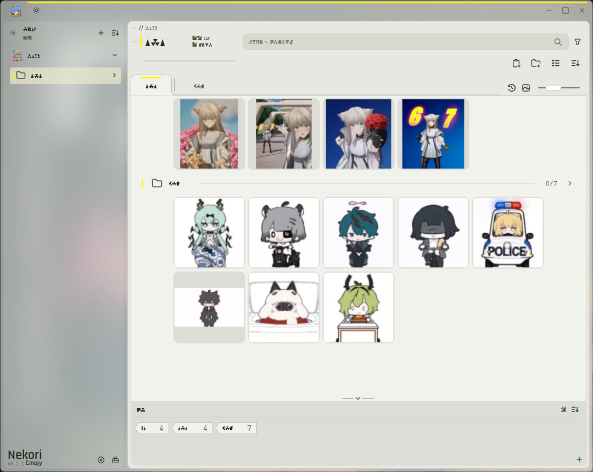

[**下载最新版本**](https://github.com/Nekori347/NekoriEmojy/releases/tag/v0.2.1) · [**问题反馈**](https://github.com/Nekori347/NekoriEmojy/issues) · [**功能速览**](#features)

---

## 功能速览

- [🗂️ **分类、子分类与节点**](#organization) — 不同层级的分类、顶部标签页、内容中可折叠和排序的分类节点。
- [↕️ **拖动与自由排序**](#drag-and-sort) — 单张或多张表情一起调整顺序，分类节点也能参与整理。
- [🔎 **查找与预览**](#find-and-preview) — 名称、标签、可选文字识别、最近使用及 GIF 缩略帧。
- [⚡ **快速使用**](#quick-use) — 一键粘贴导入、点击发送、拖动发送与快速面板。
- [🎨 **界面与个性化**](#appearance) — 深浅主题、实时调整主题强调色、灵活布局、自定义软件图标和多语言界面。
- [📦 **导入与数据管理**](#import-and-data) — 独立表情库、Suzu 数据迁移、原生资源包、兼容分享包与设置备份。

---

## 🗂️ 分类、子分类与节点

分类不只有左侧的一列文件夹。NekoriEmojy 使用同一套分类层级，根据当前位置在**左侧分类栏、顶部标签页和表情内容区域**呈现不同层级的分类。可以从大分类进入子分类，也可以直接在当前视图中整理更深一层的内容。

其中，**分类节点可以和普通表情排在一起**。一个节点可以出现在几张表情之后，而它的后面仍然是其它普通表情；节点还能够展开、折叠和调整顺序。它不是只能放在列表顶部的目录入口，也不是没有内容关系的分隔线。

这样的组织方式适合把大量表情按角色、用途或其它习惯分成几个部分：需要时展开，平时收起；也不必为每一小组都重新建立一层单独的浏览页面。

  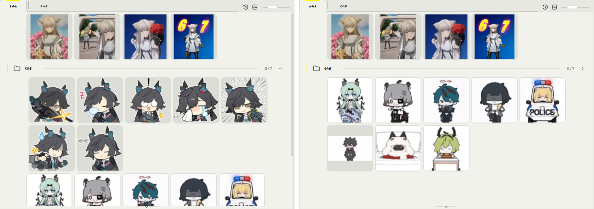

  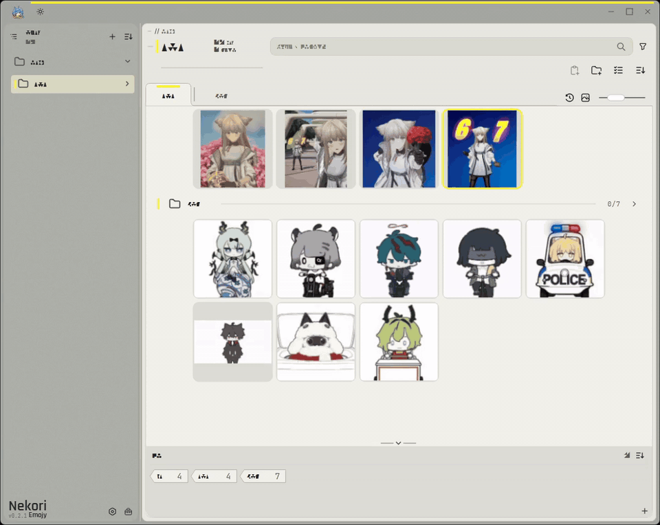

> **分类、分类节点和标签并不相同。** 分类与节点属于同一套层级组织关系；顶部标签页方便切换当前位置的分类视图；表情标签则是另一种关联和查找方式。一张表情也可以关联到多个分类，而不用重复保存图片文件。

## ↕️ 拖动与自由排序

整理时，尽量直接在表情所在的位置操作。

- 拖动单张表情改变顺序，也可以**多选后一起拖动排序**。
- 将表情拖到支持的分类或节点目标区域，按对应操作完成整理。
- 在分类视图中调整分类节点的位置，让节点与普通表情按自己的顺序穿插排列。
- 根据实际需要调整分类层级和同级顺序，不必只依赖单独的管理对话框。
- 使用标签面板和批量操作，减少逐张重复设置。

除了通过快捷键或按钮粘贴，还可以在内容区域的指定位置使用右键粘贴，将新表情直接加入当前整理位置。

下面的演示重点不是“把文件拖进文件夹”，而是**在同一个内容视图中，移动多张表情和可折叠节点，直接改变浏览顺序**。

  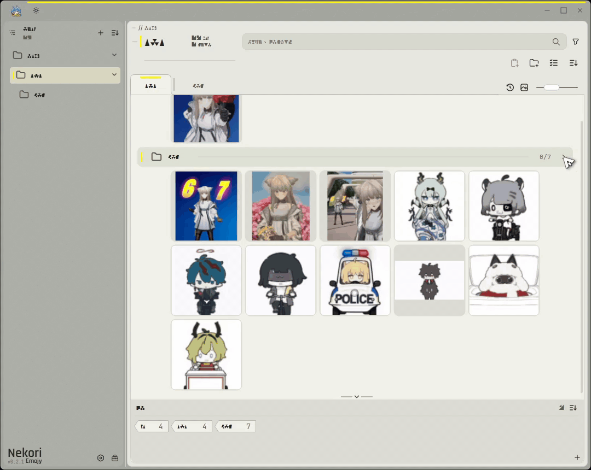

---

## 🔎 查找与预览

表情越来越多时，能否快速认出和找到想要的那张，比单纯保存进去更重要。

- **名称与标签搜索**：根据已有名称、标签和关键词缩小范围。
- **文字识别（OCR）**：按需安装本地组件，识别表情里的文字并用于搜索；识别文字与手动标签分别保存。
- **最近使用**：在主面板或快速面板找回近期用过的表情。
- **动态预览**：查看 GIF 等动态表情的实际效果。
- **自定义 GIF 缩略图停留帧**：选取更有辨识度的画面作为列表缩略图，不修改原始动图。

尤其是最后一项：如果 GIF 默认显示的是空白或动作过渡帧，可以选取更容易认出的画面，避免收藏了却在列表里找不到。

  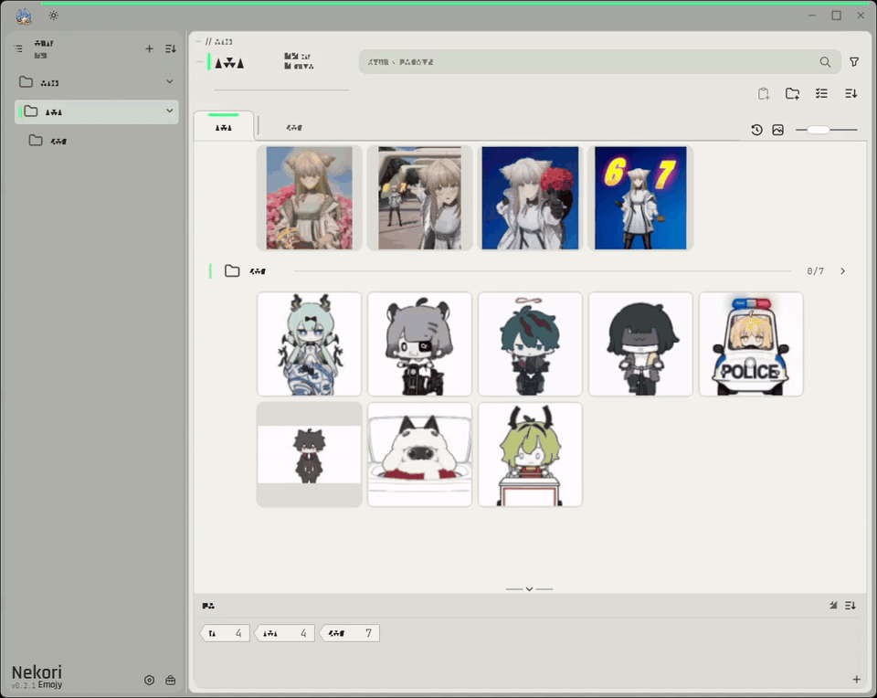

  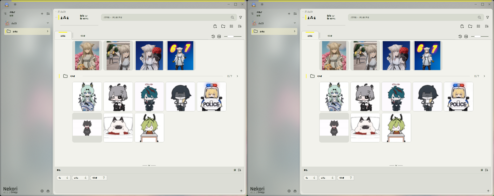

---

## ⚡ 快速使用

不需要每次都打开完整的管理界面。

- **点击发送**：在支持的目标窗口中，直接点击表情完成既有发送流程；无需每次手动切回窗口再粘贴。
- **拖动发送**：把表情拖到目标程序中需要的位置。
- **一键粘贴导入**：复制图片后，通过界面按钮将它添加到表情库。
- **快速面板**：通过快捷方式呼出紧凑面板，搜索表情或选择最近使用的内容。

主图库可设置单击表情时执行选择或直接发送，按自己的使用习惯调整。

发送方式仍受目标软件的接收方式及 Windows 窗口状态影响；不兼容的目标可以使用复制、粘贴等常规方式。

**静态表情按 GIF 发送**

部分聊天软件会将普通静态图片按较大的原图形式展示。

NekoriEmojy 提供「发送时将静态图转为 GIF」选项，可在发送时将静态表情临时转换为单帧 GIF，尝试让它以更适合表情的形式显示。

这不会把原本静止的表情变成动画，也不会修改表情库中收藏的原始图片。实际显示效果仍取决于接收图片的聊天软件。

  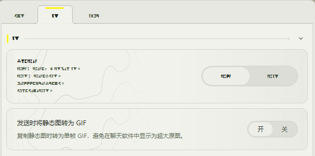

  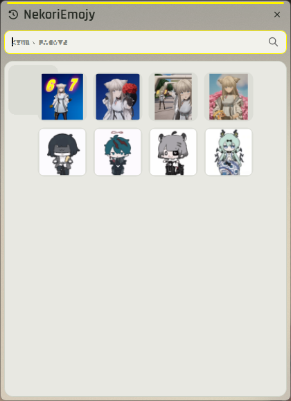

  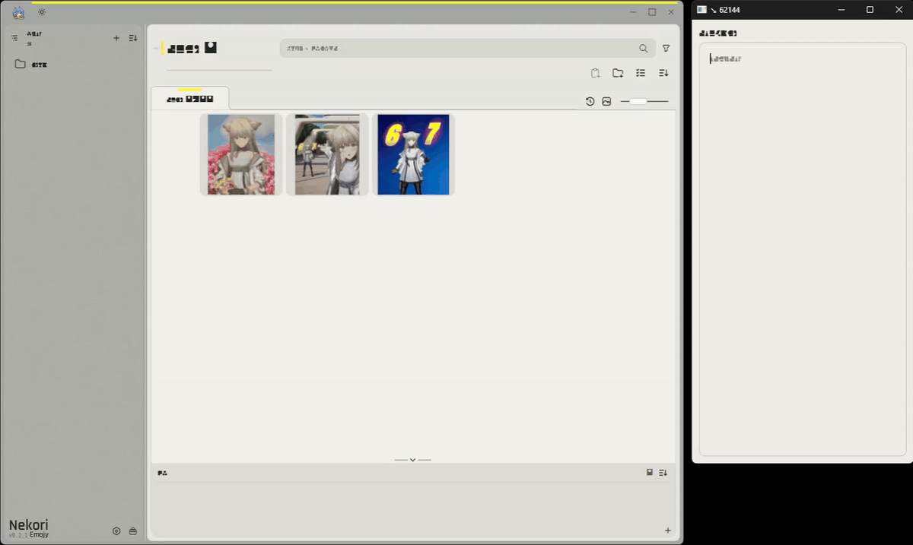

---

## 🎨 界面与个性化

界面的安排也可以按自己的使用习惯调整。

- 分类栏的不同显示模式，以及子分类与内容区域的浏览方式。
- 顶部分类标签页、可折叠节点和标签面板的组合使用。
- 标签面板的位置与展开状态、表情缩略图大小等布局选项。
- 浅色、深色主题与窗口外观设置。
- **自定义软件图标**，调整窗口、任务栏及托盘中的软件识别形象。
- **i18n 多语言界面**与可自定义的快捷键。

主面板用于整理和管理，快速面板用于更紧凑的日常查找与发送，两者共享表情数据。

### 主题与强调色

NekoriEmojy 支持浅色、深色及跟随系统的外观模式，也可以自行调整主题强调色。

调整强调色时，界面能够实时预览颜色变化，不必每次保存后再回到主窗口查看效果。不满意时可以取消或放弃修改，确认后再保存。

浅色和深色主题可以配合不同的强调色使用。

  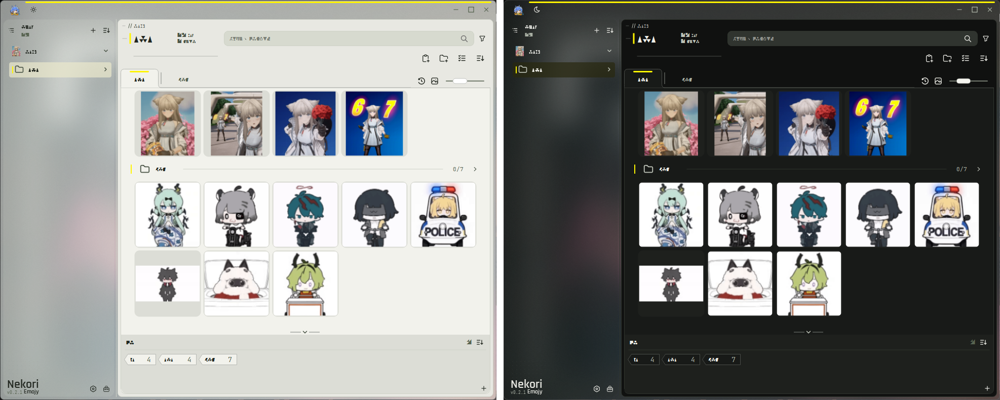

  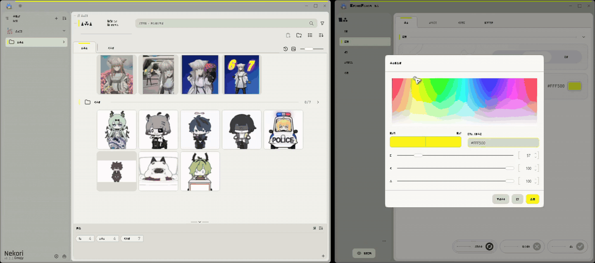

### 自定义软件图标

除了界面配色，还可以更换 NekoriEmojy 自身的软件图标。

支持从本地选择图片，也可以直接使用表情库中的图片作为软件图标。设置后会更新软件窗口、任务栏和系统托盘中的图标，需要时也可以恢复默认图标。

  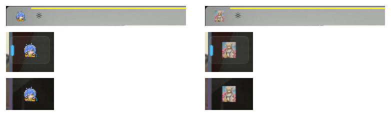

---

## 📦 导入与数据管理

除了日常收藏与整理，还提供一些维护表情库的工具：

- 导入本地文件、文件夹或剪贴板中的图片。
- 导入、导出表情合集，便于整理与分享。
- 多选管理、分类关联调整与排序。
- QQ、Telegram 等来源的导入工具，以及从 SuzuEmojy 迁移已有表情数据的途径。
- 可选文字识别组件的安装和任务管理。
- 相似图片查找：扫描表情库中的相似图片，集中预览后自行选择需要整理的内容。

不同来源和格式的适用条件可能不同，遇到不支持的内容时以软件中的实际提示为准。

### 独立的表情库目录

NekoriEmojy 的表情库不必和程序放在同一个文件夹中。

可以自行选择表情库的存放位置，例如其它磁盘或专门用于收藏图片的目录。导入的表情文件、分类信息和资源索引保存在所选表情库中，程序的个人设置则单独保存。

更换安装位置或重新安装程序时，不必因此重新整理整套表情；只要原来的表情库仍然完整，就可以通过设置重新连接。

需要注意的是，选择新的表情库后，需要保存设置并重启软件才能切换。导入表情时，程序会将图片复制或转换后保存到所选资源库，而不是直接管理原始来源文件。

这种方式也方便将表情库单独备份、迁移或存放在更适合的位置。

  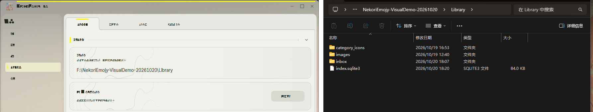

### 资源包、分享与备份

整理好的表情库也可以导出保存。

NekoriEmojy 提供几种不同用途的数据导出方式：

**Nekori 原生资源包**

可以将当前表情库导出为 ZIP 资源包。除了表情图片，还会保存分类与子分类结构、分类图标、节点与表情的排列顺序、标签、文字识别结果，以及 GIF 缩略帧选择等已记录的相关信息。

原生资源包适合保存和转移 Nekori 中的表情整理结果。导入时会与当前表情库的数据进行合并，而不是直接覆盖整个现有表情库。

  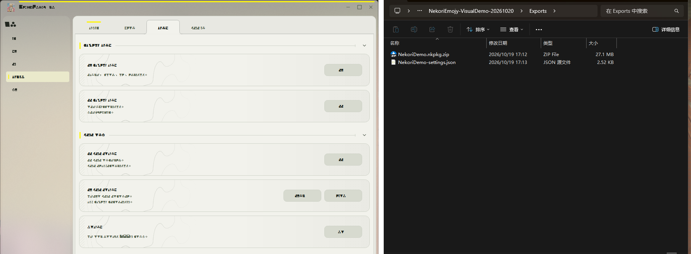

**兼容分享包**

也支持导出 Suzu 格式的表情分享包，可以导出整个表情库或指定分类，方便使用兼容格式整理和分享图片。

较大的分享包还可以按大小拆分成多个压缩包，便于保存或传输。

不同资源包格式保存的信息范围并不完全相同。如果主要目的是保留 Nekori 中的节点混合排序等整理结果，建议优先使用 Nekori 原生资源包。

**设置文件**

软件设置可以单独导出为 JSON 文件，并在需要时重新导入。

这样可以在整理表情数据之外，另外保存个人界面与操作习惯。

  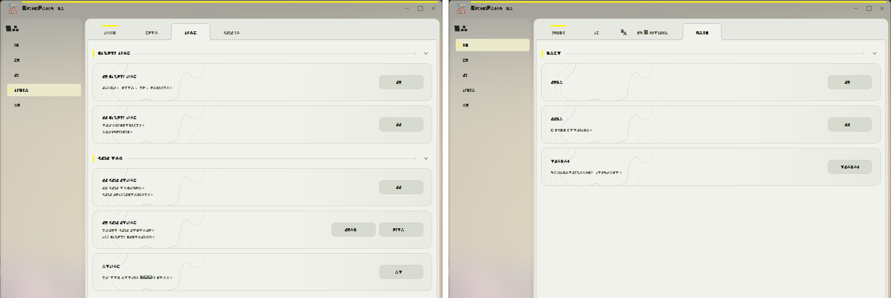

**完整数据备份**

表情库目录和应用设置分别存放。需要完整备份时，建议另外保存实际表情库目录及必要的应用数据，而不只保留一个分享包。

资源包适合导出、迁移与分享整理结果；完整目录备份则适合保留原始资源库状态。两者可以按需要配合使用。

### 从 SuzuEmojy 迁移

如果之前使用 SuzuEmojy，可以通过 NekoriEmojy 提供的迁移工具继续使用已有的表情收藏。

目前支持两种来源：

- **读取现有 SuzuEmojy 数据：** 查找本机正在运行的 SuzuEmojy 实例，读取其已有数据并迁入 Nekori。
- **导入 Suzu 分享包：** 选择此前导出的表情资源压缩包进行导入。

迁移时会尽量保留能够读取的图片、分类、子分类、分类图标、标签关键词与排序信息。原有 Suzu 数据保持不变，不需要为了迁移先删除旧软件。

由于数据来源和格式可能不同，实际能够保留的信息以源数据包含的内容为准。迁移完成后，建议检查分类、表情数量和排列结果。

这项兼容功能主要是为了减少更换软件时重复导入和重新整理表情的工作。

  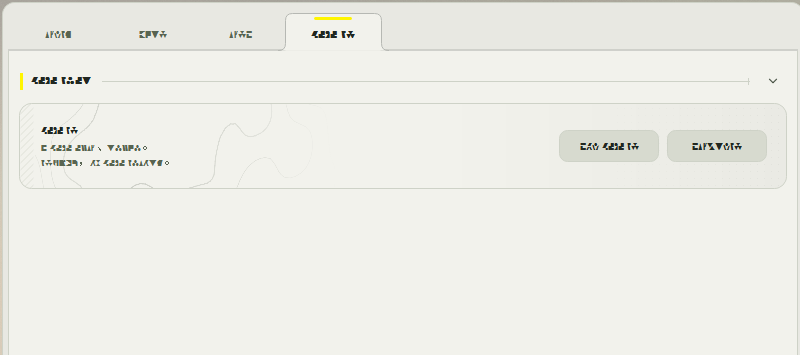

---

## 下载与使用

前往 [GitHub Releases](https://github.com/Nekori347/NekoriEmojy/releases/tag/v0.2.1) 获取最新版本。

目前准备了两种 Windows x64 使用方式：

- **安装版**：通过安装程序完成安装。
- **免安装版**：解压后按包内说明运行，适合不希望使用安装程序的情况。

文字识别属于**可选组件**。不使用 OCR 时，普通的整理、查找（名称和标签）及发送功能不需要先安装识别组件。需要识别图片文字时，再在软件设置中按提示安装。

快捷键及部分界面行为可以在设置中查看和调整。

**更新与数据：** 表情库和个人配置可能保存在不同位置。更新或更换安装方式前，建议先备份表情库与个人配置，不要把卸载或删除程序目录等同于清理用户数据。具体以对应版本的 Release 说明为准。

---

## 关于开发

NekoriEmojy 是一个个人维护的 **Vibe Coding 项目**。功能规划、界面设计和交互调整主要依据个人使用需求，代码主要借助 AI 编写、修改与迭代。

项目仍可能存在没有发现的缺陷，尤其是不同软件的拖动、发送和不同 Windows 环境下的行为差异。欢迎在 [GitHub Issues](https://github.com/Nekori347/NekoriEmojy/issues) 反馈可以复现的问题或提出改进建议。

### 维护回归门槛

每次变更统一执行 **责任层与依赖确认 → 基础冒烟及相邻回归 → 信息/数据安全检查 → 暂存审阅 → 阶段候选集成**，复用已有测试和诊断，不默认运行全仓测试或全量安全审计。

1. 确认实际责任层、复现路径和修改边界，不只按症状追加补丁；旧问题复发更新/重开原 Issue，保留历史验收。
2. 检查直接调用方、既有修复及共享层交叉风险。窗口须区分真实接收 HWND、连续缩放中的边界/内容/呈现、子窗口原生化、捕获、重开及材质；控件须区分 Hover/Pressed/Focus/Checked/Expanded 的生命周期。
3. 做基础冒烟和依赖范围的相邻回归，再做阶段候选集成。`main.py --smoke-test` 必须使用独立配置/Library并避免真实发送、抢占快捷键；Windows 原生检查显式使用 `QT_QPA_PLATFORM=windows`。命中/最终尺寸正确不代替连续过程可见稳定；offscreen、真实桌面、机器验证和人工验收分别记录。受保护实验存在时，明确加载工作树还是已审阅提交，不把实验通过当成默认版本通过。
4. 每次检查信息、隐私、文件/网络/删除边界；按下方规则和此次风险增加失败、取消及恢复验证，不机械删除合法兼容能力。
5. 提交前检查**实际暂存区**：`git diff --cached --name-status`、`git diff --cached`。核对敏感值、私人配置/资源/日志/截图、缓存、无关文件和受保护实验；核对新增第三方发送、原件读写/删除边界，以及用户文案中是否混入开发机信息。疑似匹配必须看上下文，测试假值、正常字段和技术示例不等于泄密。
6. 正式构建 Portable/Installer/源码附件/OCR 包时，另查实际输入及输出文件清单：复用 `release_layout` 正向清单、编译依赖清单和现有包清单，核对 Git 跟踪集合及实际压缩包/安装载荷，不仅依赖 `.gitignore`。排除本地凭据/配置实例、原始Library、私人资源/原始日志、DevData证据、编辑器临时文件、未批准实验补丁和意外外部资源/端点。没有授权不改写历史、替换已发布文件或上传任何证据。
7. 回归失败先归因，解决或撤回引入问题的变更，再继续扩大范围；修改前即失败的检查保留对照和限制，不删断言来宣布全绿。维护者确认连续过程前，不关闭相关回归或进入最终发布验收；未测系统/DPI/打包形态不得写成已验收。

**始终执行的信息、隐私和数据边界：**

- 开发、测试、诊断、Issue、提交和发行物不无必要包含真实 Token/密钥/Cookies/认证信息、私人账号/聊天/资源名称、完整私库清单、可识别个人的配置/目录、私人截图及未脱敏日志。用生成样本、稳定且有意义的占位信息和必要摘要；真实配置留在用户本地，不顺手清理。保留架构、格式、字段、版本/提交关联、复现依据及合法示例，不删除技术上下文。
- 外部文件名、包内路径、网络返回和配置均须经现有业务合同验证，不能决定任意文件读写；保护路径边界、目标文件、受管理原件和多分类引用。外拖继续交付独立副本；失败、取消及恢复不能破坏已可靠提交的数据。安全兼容可恢复部分继续保留，不以安全名义取消合法导入、迁移或旧配置能力。
- 第三方数据发送范围不得静默扩大；复用现有 Token/代理/超时/重定向/隐私告知规则，不把自定义凭据发往非授权代理。日志/异常报告继续脱敏、轮转及有界留存，诊断只由用户主动导出，不自动上传。不另建权限、日志或安全框架；具体既有边界见 [轻量安全与兼容记录](docs/LIGHT_SECURITY_NETWORK_REVIEW.md)。
- 普通操作 Tooltip 用面向用户的动作与结果表达，不写 AI 口吻、开发意图、内部状态名或开发机路径；必要技术详情留在合适的故障说明/诊断入口，不删除有用错误信息。

| 修改风险 | 必要检查增量 |
|---|---|
| 普通图标/布局 | 基础信息检查和相邻 UI 回归 |
| 窗口宿主/主题/共享控件 | 共享交互、状态、连续过程及材质/布局交叉回归 |
| 网络/压缩包/删除/日志/凭据/原生桥接 | 对应安全边界、第三方发送与失败/取消/恢复路径 |
| 正式构建 | 实际输入、跟踪集合与输出载荷专项检查 |

不另建重复规范、测试台账或扫描平台；不因没有执行全量安全审计而放弃基本安全规则。有限验证与环境边界见 [窗口记录](docs/POST_0.2.1_WINDOW_CLOSEOUT.md) 和 [HSV 调查](docs/HSV_INTERACTION_INVESTIGATION.md)。

---

## 开源项目与致谢

**SuzuEmojy**

NekoriEmojy 以 [SuzuEmojy](https://github.com/IxinorTyan/SuzuEmojy)（IxinorTyan）的开源代码为开发基础，在此基础上继续调整了表情库的数据组织方式、分类与节点交互、界面布局以及其它日常使用细节。

感谢原作者开放项目源码，也感谢相关开源项目及第三方组件作者的工作。

SuzuEmojy 原项目采用 GPL-3.0 许可证。项目本身及第三方代码、资源的具体授权信息以仓库中的 LICENSE 和相关许可文件为准。

部分发布截图使用 [Endfield_Font](https://github.com/lhclbt/Endfield_Font) 的社区复刻字形作临时展示文字（作者：lhclbt / 罗醭坦；[CC BY-NC 4.0](https://creativecommons.org/licenses/by-nc/4.0/)）。该字体不作为 NekoriEmojy 正式程序的内置资源。

项目与第三方组件的具体授权、署名及适用范围，请参阅仓库中的 [LICENSE](LICENSE) 与相关许可文件。

---

*这是一个仍在完善的个人工具，介绍与演示以对应发布版本的实际功能为准。*
