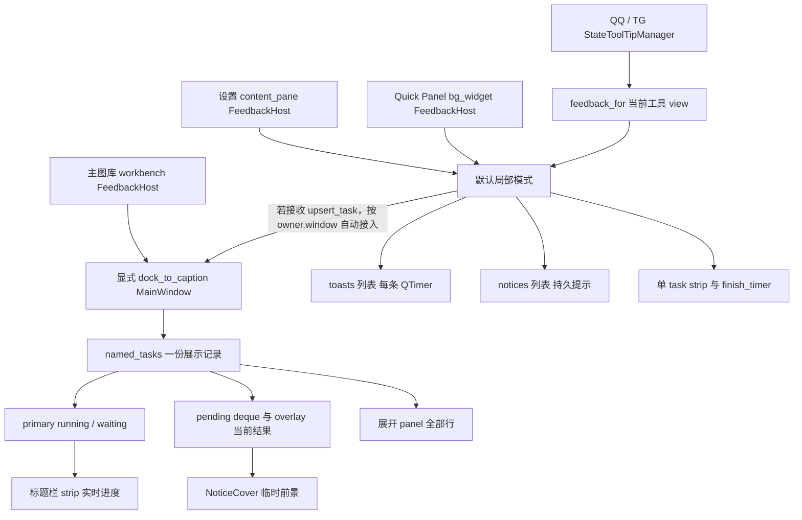

# 排序 Tooltip 与通知栏交互定向事实调查

## 正式整改实施结果（2026-10-27）

本节替代下方“只调查、未修复”的当前状态；下方原始事实保留为 **5529adb历史快照**。正式授权基线5529adb，源码 **174d9bf**（排序完整绑定/锁定翻译）、**3577821**（控制区/双通道/真实剩余时间/倒计时）。两者已本地提交、机器验证，仍待维护者人工体验；记录提交及最终HEAD见CURRENT/#37。不扩展通知中心或窗口宿主。

### 责任层与实现

- SortCycleButton仍负责分类/Tag，ResourceSort及原调用方仍负责表情。九个完整源键×四语言原样接入，单行Tooltip及AccessibleName同步；模式与语言刷新不重置排序，不改排序算法/存储/分类槽位。移除的是两组常驻Tooltip的第二行，既有非手动重排阻止与hint保持。另三个通知控制键×四语言精确接入；旧词典键保留。tests/fixtures/notification_tooltip_copy.json锁定12键/48语言值，整字典对5529adb仅允许该映射新增，前三批/第四批旧值不改。
- CaptionFeedback保留named_tasks、primary、pending、overlay身份与顺序；未合并业务队列。TaskEar继续原形状并复用ButtonPaint已有输入来源/焦点/Hover生命周期，自身绘制只补线条色、按压/键盘提示；垃圾桶继续TransparentToolButton、SVG、danger role。没有新增公共按钮或工具栏窗口。
- distinct=len(named_tasks)资格与交互可见性分开；0/1条隐藏耳朵并收起。>=2条在相关悬停/键盘焦点、已展开或真实离开后的原180ms桥接期间显示。进入不再自动展开，点击切换；列表/按钮/通知区之间移动沿同一hover集合和短延迟处理；自动焦点安置不会凭空触发展开按钮短暂出现。
- clear仅在>=2条、opened且展开动画已到可交互终态、clearable_tasks非空、窗口可见时显示；收起开始即隐藏。其success/info且无resume/details安全条件不改，仍调用原clear_completed，仅移除展示记录，不调用cancel/resume、资源删除或持久任务清理。减少到1条立即收起。
- 控制区在现有列表末端统一计算：panel只占行区域；两按钮共用底部带，垃圾桶在耳朵左侧。带高度取实际控件高度，展开时纳入原material范围，收起后不保留空白带；耳朵在过渡中始终位于行区域之后，清理在过渡未可交互时隐藏。没有用孤立raise/负margin/透明大命中区补救相交。
- 标题栏按当前bounds在同一行划分任务与结果区域，窄窗优先保留类型图标、进度/数字及真正操作，标题省略；NoticeCover不再抓图盖住任务，不修改原轮廓圆角与材质色。行和标题复用局部几何计算，任务取消/详情与通知关闭/详情分别绑定自身key。监听原标题控件实际Move/Resize/Show后读取bounds，避免只在window Resize过滤器中过早读旧位置；不改宿主resize算法、DWM或W02。
- DisplayDeadline是现有QTimer上的轻量显示时限封装：记录total、真实remaining、paused、key/generation，QElapsedTimer单调计时。Caption仍只有原overlay_timer决定超时，普通Toast仍每条原timer；新有限QVariantAnimation只请求局部细线重绘，不裁决过期。停止/换key后旧到期事件不能结束新展示。
- Caption悬停当前封面/通知列表/控制区、或相关真实键盘焦点时暂停；离开保存并续计剩余，不重置全时长。排队项未轮到不计时；明确reannounce才重启本次完整周期。普通Toast由Enter/Leave停整表重启改为保存/恢复真实剩余；明确重复展示可重新发布，退出中的旧动画会停止而不会删除新展示。
- CountdownLine只画在当前NoticeCover或自动Toast的内部下边缘，1逻辑px、Accent、无轨道/无高度变化，右端按真实remaining/total收缩；活动进度、持久列表行、无期限notice不画。RETAINED只表示封面展示时限，历史仍保留。关闭/清空/移除/换项/宿主销毁清理原timer/有限动画和QObject连接；销毁中的焦点回调检查真实Qt对象有效性，避免访问已销毁宿主。
- 动效关闭隐藏细线并停止它的绘制驱动，原到期QTimer继续；重开按真实剩余恢复，不生成通知或重启时间。主题/Accent只触发绘制颜色更新。隐藏窗口清掉悬停暂停并继续原时限，不将不可见视为新暂停条件。

### 显隐矩阵（定向检查）

|记录/交互|耳朵|清理|行为|
|---|---|---|---|
|0条|隐藏|隐藏|无列表|
|1条活动/成功/保留结果|隐藏|隐藏|同key进度更新不增加数量|
|>=2条，收起，无相关悬停/键盘焦点|隐藏|隐藏|保留独立记录|
|>=2条，通知区悬停或相关键盘焦点|展开提示|隐藏|点击展开，经过不会自行展开|
|展开且只有活动任务或RETAINED/带操作结果|收起提示|隐藏|记录仍可查看|
|展开终态且有可清理success/info|收起提示|显示|清理后不取消活动任务|
|展开/收起中间帧|按交互保留|隐藏|控制锚点不进入列表或封面|
|减少至1/0条、窗口隐藏|隐藏|隐藏|立即收起/隐藏；隐藏继续超时|

### 实际Qt几何与命中

Win11真正Windows Qt后端，生成消息、独立配置、HEAD宿主（不加载W01实验）。100%和受控150%各覆盖四语言×深浅×1080/680宽，共每档16组布局；另检查真实中间帧与倒计时像素。实际widget截图已查看，无私人内容、未进提交。

100%三条混合记录、展开终态的窗口逻辑QRect：

|组件|1080宽|680宽|
|---|---|---|
|任务strip|[92,8,461,24]|[92,8,241,24]|
|临时NoticeCover|[578,8,334,24]|[341,8,189,24]|
|列表panel|[80,33,850,162]|[80,33,450,162]|
|清理按钮|[478,199,22,22]|[278,199,22,22]|
|展开耳朵|[506,203,36,14]|[306,203,36,14]|

两通道无交集；清理按钮与列表/封面无交集，原7/8逻辑px遮挡已消失。两按钮四角内侧均由window.childAt命中自身，实际Qt点击清理按钮上角可清理；任务进度3/10→7/10在通知存在时继续，清理后任务及cancel回调保持。150%同样满足边界/命中断言，没有将Win11结果外推Win10/混合屏。

### 计时与回归证据

- 共 **45个不同定向/相邻用例**分组通过：排序2、新通知17、实际宿主矩阵1、旧Caption8、旧清理1、TP-A5、#60生命周期8、TPB整字典保护2及原图库排序/语言绑定1。重复运行和两档布局不重复计数。
- Windows150%组合 **33项**通过，包含新通知17、排序2、矩阵1、TP-A5、#60 8；100%宿主矩阵另通过。测试使用Qt本地事件，不独占系统鼠标、不操作正式版/真实目标。独立配置/生成Library的main启动退出冒烟通过。
- 普通Toast生成220ms测试：部分消耗后悬停80ms剩余量稳定，移出后remaining小于原duration、按保存量续计。Caption生成240ms场景：部分消耗后悬停80ms波动<5ms，队列项不启动；明确重报使generation递增并重置真实默认时长，随后到期串行换项。有效动效关闭时细线隐藏/有限动画停止，等待后原timer仍能移除结果；重开及Accent变化不改generation/剩余时限。RETAINED封面到期保留字典记录，旧到期回调不能结束新key。
- 初始红色回归确认旧拼接文案、收起垃圾桶、双通道相交及原计时能力缺口。旧测试按正式新合同改为“通知区显按钮、点击展开”，并补完整的Enter/Leave桥接；动画等待改用实际finished信号而非猜固定延迟。既有取消、清理安全范围、任务优先级及原更新下载阶段断言保留（旧“立即更新”断言按上一批已批准“下载更新”修正），没有改产品文案来迎合旧断言。
- 未真实导入/删除/更新安装/下载、QQ/TG联网、OCR、导出私人诊断或上传。没有全库扫描、全窗性能审计或修改其它视觉。有限更新仅在当前展示且动效开启时运行，不为隐藏/排队消息持续刷新。

### 尚待维护者体验与明确边界

- 仍待人工体验：悬停桥接的手感、窄窗文字省略、TaskEar轻量反馈和1px倒计时线、真实工作中任务/提示并存。Win10、混合DPI/跨屏、极端小于现有窗口最小宽度、真实工具线程结束时序未验；不宣称跨系统最终验收。
- 按已批准的0/1条隐藏合同，单独一条RETAINED结果封面到期后仍存记录，但没有常驻展开耳朵；再次达到2条时可从既有列表查看。本轮没有擅自新增单条历史入口，亦未将它自动删除。
- 无新增已知阻断回归；#62/#60保留各自待人工状态，不因本轮关闭。七处W01原差异不暂存/不改，W02暂停、W03不启用；正式版、原Library、Demo数据/排序及Suzu不操作。不Push/打包/发布。
- 本轮只做授权排序和通知组件，不继续主动开发其它反馈或UI。最终HEAD见CURRENT/#37。

## 以下为5529adb的原始事实调查

2026-10-27；基线 **d6b98e1 / dev/post-0.2.1**。追踪#37，涉及既有#62/#60。仅静态阅读、独立Qt宿主及合成消息，无正式业务/UI/翻译/测试断言修改。本轮不冻结新交互，不创造文案/译文；文档提交后停止。维护者补充的九项中文为候选，不是替换授权。

## 1. 摘要与保护状态

- 开始及结束前，工作树只有原七处保护差异：docs/POST_0.2.1_HANDOFF.md（+2/-2）、docs/POST_0.2.1_PLAN.md（+2/-2）、fluent_ui/main_window.py（+1/-13）、materials.py（+15/-10）、window_shell.py（+12/-12）、tests/test_ui_tail.py（+2/-2）、test_window_resize.py（+0/-10）。未reset/stash/覆盖/暂存它们，原暂存区空。主窗口/宿主的源码关系读HEAD，实际隔离Qt加载HEAD宿主，不把W01实验当默认代码。
- **已确认**：收起后的垃圾桶仍可见是显隐条件未依赖opened；顶部通知覆盖其上部7逻辑px、展开列表覆盖上部8逻辑px，实际Qt命中随遮挡落到通知文字；垃圾桶本身已经是共享正式按钮与SVG图标，并非字体符号或临时按钮。
- **已确认**：展开耳朵按“除当前显示项外还存在记录”显示，不依赖鼠标或opened；记录包括活动任务与保留结果。警告弹层过期仍保留历史，因此只有一条保留记录也能继续出现耳朵，不等于过期临时成功通知未清掉。
- **已确认**：进度与临时结果在标题栏保留两个逻辑通道，但共享named_tasks数据表和标题位置；临时结果出现时NoticeCover视觉上盖在进度之上，后台任务仍在更新，展开列表可同时显示。后续不能把两类合并/删一类；“数据并存”不等于当前两个独立并排显示区。
- **计时差异**：Caption临时弹层单overlay_timer串行展示，没有悬停/焦点暂停。普通Toast每条QTimer，Enter停表、Leave重启全时长，未保存真正剩余量。现有实现尚不具备产品要求的“悬停后按剩余时间继续”合同。
- 未Push/打包/发布；W02暂停、W03未启用；正式版、原Library、Suzu、固定Demo与其排序不操作；TP-A/TP-B四批代码及字典未改。

## 2. 排序：实际九态、四语言与候选对照

复用[TPB_COPY_FACTS.md](TPB_COPY_FACTS.md)的TPB-026～031、101～103；该表是旧采集快照，本节以d6b98e1的当前调用方为准，不重新审前三批其它文字。

### 2.1 当前可见原文

下表四语言为当前运行中的真实toolTip()或当前实际资源刷新函数输出；候选栏只原样引用维护者提供的中文，没有补译。36个组合均无[MISSING]；这不是全软件缺译统计。

|入口 / 实际模式|指导AI中文候选（未实施）|当前zh|当前zh_TW|当前en|当前ja|
|---|---|---|---|---|---|
|category / manual|分类排序：手动|分类显示排序 · 手动顺序 临时显示排序，不改动手动顺序|分類顯示排序 · 手動順序 臨時顯示排序，不會改動手動順序|Category display order · Manual order Temporary display order; the manual order is unchanged|カテゴリの表示順 · 手動の順序 一時的な表示順です。手動の並び順は変更されません|
|category / a_z|分类排序：名称 A→Z|分类显示排序 · 名称 A→Z 临时显示排序，不改动手动顺序|分類顯示排序 · 名稱 A→Z 臨時顯示排序，不會改動手動順序|Category display order · Name A→Z Temporary display order; the manual order is unchanged|カテゴリの表示順 · 名前 A→Z 一時的な表示順です。手動の並び順は変更されません|
|category / z_a|分类排序：名称 Z→A|分类显示排序 · 名称 Z→A 临时显示排序，不改动手动顺序|分類顯示排序 · 名稱 Z→A 臨時顯示排序，不會改動手動順序|Category display order · Name Z→A Temporary display order; the manual order is unchanged|カテゴリの表示順 · 名前 Z→A 一時的な表示順です。手動の並び順は変更されません|
|tag / manual|标签排序：手动|标签显示排序 · 手动顺序 临时显示排序，不改动手动顺序|標籤顯示排序 · 手動順序 臨時顯示排序，不會改動手動順序|Tag display order · Manual order Temporary display order; the manual order is unchanged|タグの表示順 · 手動の順序 一時的な表示順です。手動の並び順は変更されません|
|tag / a_z|标签排序：名称 A→Z|标签显示排序 · 名称 A→Z 临时显示排序，不改动手动顺序|標籤顯示排序 · 名稱 A→Z 臨時顯示排序，不會改動手動順序|Tag display order · Name A→Z Temporary display order; the manual order is unchanged|タグの表示順 · 名前 A→Z 一時的な表示順です。手動の並び順は変更されません|
|tag / z_a|标签排序：名称 Z→A|标签显示排序 · 名称 Z→A 临时显示排序，不改动手动顺序|標籤顯示排序 · 名稱 Z→A 臨時顯示排序，不會改動手動順序|Tag display order · Name Z→A Temporary display order; the manual order is unchanged|タグの表示順 · 名前 Z→A 一時的な表示順です。手動の並び順は変更されません|
|resource / manual|表情排序：手动|表情显示排序 · 自定义顺序|表情顯示排序 · 自訂順序|Emote display order · Custom order|スタンプの表示順 · 手動順|
|resource / recent_added|表情排序：最近添加|表情显示排序 · 最近添加|表情顯示排序 · 最近新增|Emote display order · Recently added|スタンプの表示順 · 新しく追加した順|
|resource / oldest_added|表情排序：最早添加|表情显示排序 · 最早添加|表情顯示排序 · 最早新增|Emote display order · Oldest added|スタンプの表示順 · 古く追加した順|

### 2.2 调用关系及功能事实

|入口|当前控件/触发/持久化|真实排序语义|
|---|---|---|
|分类|presentation/sidebar.py:33–40创建SortCycleButton('分类显示排序')；点击_cycle → mode_changed → CategorySidebar.set_display_sort:449；保存sidebar_sort；tree.set_display_sort及icons投影刷新|manual / a_z / z_a，与tree兼容name_asc/name_desc转换；名称经SectionKeyProvider拼音/casefold排序及分段，不改兄弟手动位置|
|标签|tag_panel.py:467–469的SortCycleButton('标签显示排序')；_on_sort_cycled → set_sort:732 → 保存tag_sort → SectionedProjection|manual / a_z / z_a；只有manual允许手动Tag拖排，不把字母序写回TagOrderModel|
|表情|presentation/workbench.py:121–124的TransparentToolButton；点击按ResourceSort枚举循环 → GalleryInterface.set_content_sort:3727 → 保存resource_sort → 刷新图库；非SortCycleButton|manual / recent_added / oldest_added。按资源library_added_seq，且只在两个分类节点间连续资源段内排序；节点仍是结构边界。不是文件修改时间、不是名称排序|

- 九项候选与当前实际模式一一对应。“表情排序：手动”对应当前中文显示“自定义顺序”的同一个ResourceSort.MANUAL，没有第二个“自定义”业务状态。分类/标签的MANUAL是各自独立顺序模型，不能因为名称相同就共用排序集合。
- 分类/标签共享navigation.py:29–64的SortCycleButton.refresh：逐片t(title)、t(label)、t('临时显示排序，不改动手动顺序')，再拼为两行；AccessibleName等于该Tooltip。组件直接监听language_changed及theme.changed，set_mode/_cycle立即刷新，模式不因语言变化重置。实际实例A_Z保持不变的四语言切换已核对。
- 表情由gallery_view.py:3737–3744调用方生成，两片各自t后拼接，直接setToolTip，不再把组合串传bind_text（历史TPB-029～031的二次查译已由第一批修正）。GalleryInterface:874监听language_changed，经refresh_texts:1731调用_update_resource_sort_label；本轮合成对象实际调用该函数，整体Gallery语言信号链为静态确认，没有创建Library验证。
- 当前十个独立翻译源片：分类显示排序、标签显示排序、表情显示排序、手动顺序、自定义顺序、名称 A→Z、名称 Z→A、最近添加、最早添加、临时显示排序，不改动手动顺序。前三语言字典均能精确命中；zh以源文为准。不是九条整句翻译键。没有为候选中文创建四语言条目。
- 共享SortCycleButton目前只有分类/标签两处实际调用。移除其第二行在技术上只会改变这两组常驻Tooltip及AccessibleName，不改变排序计算/保存/禁用逻辑；资源按钮原本没有此行，不能通过改共享组件顺便统一它。
- “不会改动手动顺序”在当前两行提示中有明确说明。若未来移出该行，其它入口没有被源码保证总会展示等价解释。资源操作的_manual_order_available:3760在搜索/临时排序时独立给hint；管理排序按钮有独立禁用原因；Tag Flow在非manual拖动时发manual_required，Gallery在1017–1020独立提示“切换到手动顺序后可调整顺序”。这些操作限制不依赖排序Tooltip的文案，也不会因移除第二行自动消失，但不能据此证明用户理解一定不受影响。说明迁移到何处由指导AI决策，本轮不提供替代措辞。
- 全局TooltipSurface/GlobalToolTipFilter只消费控件toolTip属性并负责显示/生命周期；候选文本接入不需要重新处理TP-A主题问题。没有证据表明当前机械重复是黑块修复或Tag覆盖造成。

## 3. 宿主与生命周期

证据：FeedbackHost:77/164/417/473；CaptionFeedback:140/192–262；presentation/workbench.py:159–162；presentation/settings.py:77；quick_panel.py:63–67；StateToolTipManager全文件。MainWindow HEAD中GalleryInterface创建时parent=self；ToolWindow只把既有view嵌入自身，不另建全局通知中心。SettingsWindow经center、ToolWindow经view、MainWindow经gallery_interface解析，feedback_for优先已有feedback_host，宿主不串到其它窗口。Quick Panel普通反馈显式使用bg_widget自己的host。

### 3.1 标题栏模式

- named_tasks为该FeedbackHost的展示字典；每项包含title/current/total/state/content/kind/cancel/resume/details/action_text/phase。_named_widgets为对应控件映射；_named_timers当前只有初始化和remove时清理，没有实际启动者，不能误说它在逐任务计时。
- ACTIVE为running/waiting，RETAINED为error/warning/partial/cancelled/interrupted。primary优先保留原running，否则选running，再waiting；ordered依活动→waiting→保留结果→其它排序，稳定保留同级顺序。
- 非ACTIVE的新项/状态变化入pending；next_overlay一次取一项并启动唯一overlay_timer；其它等待项尚无逐条运行的寿命，不因排队时间长而“过期”。同状态内容更新本身不一定重新入队；toast/notice显式reannounce会重置当前项或把它放回队列。
- Legacy task()/finish()也映射到key='legacy'，与专名任务同池。task_active主要是legacy兼容标志，不能当作named_tasks中所有后台任务是否存在的唯一依据。legacy task还可使用kind='notice'但state='running'，所以未来倒计时不能只按kind=='notice'识别临时结果。
- 临时结果和进度不相互取消。实测job current=2/10与notice共存，清理通知后job字典不变、cancel回调不调用。NoticeCover会抓取进度条局部快照并轻度模糊，实时进度控件仍在其下，超时后恢复主任务；这不是新建任务或重新执行工作。

### 3.2 非标题栏模式

- toasts列表最多3条，重复message在非underMouse时重启原timer；过量移除最旧项。新toast默认2600ms，warning为5500ms。它与任务strip独立，可以叠加。
- notices列表按title/content去重，默认不自动过期。任务正在进行时notice先排队，不覆盖活动任务strip；task.finish成功显示终态3500ms后finish_timer恢复最后notice或隐藏strip；非成功finish转notice。dismiss非活动时会清理该局部notice队列。
- 因此只有默认局部toast才是“每条一只QTimer”；caption是串行overlay_timer；legacy结束有finish_timer。不是统一的两套平行列表/统一寿命。主窗口与工具/Quick Panel不能仅凭视觉都叫“通知”就假设相同路径。

## 4. 展开／清空／关闭的精确条件

|问题|当前事实与源码|
|---|---|
|展开按钮何时显示|CaptionFeedback.refresh:257附近，key=overlay or primary；extra=any(k!=key for k in named_tasks) or (key is None and bool(named_tasks))；visible=extra and window.isVisible。不是“鼠标在通知区”、不是只按临时通知数量>1|
|展开按钮是否常驻|只要extra为真就显示；有running且收起/系统与应用动效均允许时，点阵1800ms循环提示。没有超时自动隐藏耳朵的独立条件|
|垃圾桶何时显示|reposition:451，只看bool(host.clearable_tasks()) and window.isVisible；**不检查opened/ear.visible/是否悬停**。单条成功结果也能显示垃圾桶而耳朵隐藏；收起不隐藏它|
|清理对象|clearable_tasks:459，仅state为success/info，且无resume、无details。warning/error/partial/cancelled及带详情/继续操作的结果不属于此集合；不是所有“已完成”记录|
|数量包含进行中任务吗|包含。ear.extra、ordered、desired行高全部基于named_tasks，没有临时通知专用数量筛选，也没有单独badge计数器|
|收起做什么|collapse置opened=False并把expansion动画到0，完成后隐藏panel、保存滚动位置，丢弃panel的hover标记。记录、primary/overlay、timer都不改变；clear_button仍按原条件计算|
|关闭一条后|行close→remove_task(key)；封面close→dismiss→remove_task(overlay)。removed清pending/当前overlay/primary，next_overlay再refresh，重新算ear、clear、列表几何；没有重置后台任务进度|
|过期项是否仍计数|success/info普通结果到期会remove_task，不再计数；RETAINED只撤销当前overlay，历史仍在named_tasks并计数；排队项尚未开始计时，不是“过期遗留”|
|清空会不会取消后台任务|clear_completed只逐个remove_task(clearable)，然后collapse；不调_task_action、cancel或resume。remove_task删除展示字典/控件、记_dismissed_task_states防同终态重放，不删除持久任务数据库/缓存/资源。不应把“显示记录被移除”写成所有任务记录未变化|
|窗口隐藏|Hide隐藏相关控件及停止耳朵动画，但不停止overlay_timer；因此后台隐藏期间也可到期。失活未对该timer专门暂停|

**明确区分**：单条手动关闭、清空多个可清理结果、到期自动移除/保留历史，三条路径不等价。当前标题栏ACTIVE行没有关闭按钮，操作按钮走现有cancel；人工关闭结果不会撤销已完成工作。

## 5. 几何、层级与真实命中

### 5.1 有界复现环境

独立配置、无Library业务、生成英文通知。Win11实际Windows Qt后端，载入HEAD NekoriWindow，共享正式标题栏/FeedbackHost/CaptionFeedback/按钮，测试脚本仅在DevData私有证据目录，未进提交。以Qt事件和childAt进行局部命中，不使用系统鼠标拖动、不操作正式软件。一次100%样本、一次QT_SCALE_FACTOR=1.5独立进程（报告DPR确为1.5），加一组有限的宽度/过渡/点击补充；没有扩大到全窗缩放或W02调查。

覆盖：单进度、单结果、多结果收起/展开/再收起、进度+结果、2→1→0、真实2600ms到期、悬停/失活、重复提示、动效开关、保留警告的显示超时。截图查看过收起/展开真实widget抓图；没有引用维护者私图或私人资源。

### 5.2 共同坐标与重叠

下表QRect为窗口逻辑坐标[x,y,w,h]，1080px宽；同一公共父对象window，非不同坐标误比较。

|组件|两结果收起|两结果展开|
|---|---|---|
|strip|[160,8,730,24]|[160,8,730,24]|
|NoticeCover|[426,8,151,24]|[426,8,151,24]|
|panel|[148,33,742,0]（隐藏）|[148,33,742,126]|
|TaskEar|[506,28,36,14]|[506,154,36,14]|
|clear_button|[482,25,22,22]|[482,151,22,22]|
|clear与cover相交|[482,25,22,7]|无|
|clear与panel相交|无|[482,151,22,8]|

- 几何来源reposition:434–455：ear定位在material区域底部附近；clear在ear左24px、上3px。并未在列表布局中为clear预留一行。clear、panel、ear、material、cover都是window直接子控件；panel里的rows属于滚动内容。clear没有加入panel/header布局，位置完全由上述绝对几何计算。
- 叠放顺序同一函数先clear.raise_，随后material/strip/panel/ear.raise_，最后NoticeCover.present内部再次raise_。因真实几何有交叠，后画层盖住clear上沿；不是纯图标颜色问题。material虽透明鼠标但会绘制底面，panel/cover/front/label通常可接鼠标，故视觉和命中都可能受影响。
- 实际childAt：垃圾桶窗口坐标中心x、局部y=1命中FeedbackTitle（收起为封面文字，展开为行文字），y=10及20命中TransparentToolButton。向实际命中的上部文字发送Qt左键，无clear.clicked且仍2条；向露出的下部button发Qt左键，clear.clicked一次、2条均清掉。不是按钮完全没有点击处理。
- DPR1.0与1.5的逻辑相交量一致（7/8px），物理像素随DPR缩放。此证据只覆盖本机/Qt缩放设置，不外推混合屏DPI或Win10。
- 窄窗680px补样：Resize后strip一度保留[216,8,674,24]，右端超过窗宽；160ms后没有自行重新定位，下一次展开/布局更新后变为[177,8,352,24]。eventFilter在Resize时直接refresh，bounds依标题栏minBtn及标签实际geometry，存在先读旧几何再无后续刷新的可疑时序；**事件先后为推断，尚未完整记录titleBar布局序列**。已确认的是该合成宿主有失效几何缓存表现，不能断言正式所有窄窗均如此，也不归因W02、DWM或DPI。
- 动画补样expansion约0.215及0.761时clear分别y=52和121，最终展开y151、收起y25。按钮随extent移动，但仍未获得独立保留带；没有先定义几何边界便单加raise不能消除相交。本轮未改变任何路径/层级/坐标。

### 5.3 垃圾桶与展开控件的状态来源

- clear是controls.TransparentToolButton(ButtonPaint, FluentTool)，22×22，图标14×14，Icon.DELETE='trash'经QSvgRenderer渲染；role='danger'，Tooltip及AccessibleName均绑定“清理已完成通知”。不是字体垃圾桶符号，亦不是普通QLabel。
- ButtonPaint:71–292已提供：ghost常态无整块背景；Hover小幅覆盖、Pressed加深、Disabled降不透明度、真实键盘来源Focus轮廓；hide/UngrabMouse/窗口激活及几何变化沿#60清理。该按钮并非缺少所有正式状态。当前无常态外框/底板，是既有ghost规则；是否改成更显眼正式风格仍待指导AI冻结，不能凭截图就重画或认定#60缺失。
- TaskEar是独立QAbstractButton，自绘三点/向上折线与边框，不继承ButtonPaint。其paintEvent没有按isDown/underMouse/keyboard_focus_visible改变颜色的分支；Enter会展开，Leave触发180ms收起判断。它的“持续显示”首先来自extra条件，不是已证实的Hover状态残留。

## 6. 计时能力、暂停和动效

|路径|时长/开始|当前暂停/重置|到期与动画|
|---|---|---|---|
|普通Toast|constructor(duration)立即启动单次QTimer；FeedbackHost.toast无duration公开参数，按2600ms或warning5500ms创建；直接Toast构造可自定义|Enter停timer并停止退出淡出、恢复opacity；未存remaining。Leave重新start(self.duration)。相同message更新且非underMouse重启；不是按剩余时间续计|timeout置_exiting=True并用原opacity动画退场，finished再expired→移出toasts；退场中仍可能在toasts/布局中。Enter可取消退场；动效关闭时原零时长路径提交终态，正常移除|
|Caption overlay|next_overlay/reannounce按RETAINED5500、success3500、其它2600ms；单overlay_timer只管当前弹层|没有Enter/Leave/Focus暂停。ear/panel/clear的hovered+leave_timer只管展开列表自动收起。重复reannounce当前key重启整段时长|timeout立即撤cover并切下一项；普通结果remove，RETAINED留历史；当前NoticeCover无自己的进出淡出动画|
|legacy非caption任务完成|finish_timer3500ms，仅成功终态展示|活动任务会stop完成timer；无通用focus/hover暂停|到期恢复已有notice或隐藏；不是独立Toast倒计时|

运行观测（耗时会含Qt事件调度，非性能benchmark）：caption hover前3468ms→3297ms仍在倒数且opened=True；失活3292→3176ms；重复同key重报恢复约3496ms；切换动效3489→3354ms仍active。普通Toast在约2480ms时Enter，timer inactive；Leave回2600ms。动效关闭的info通知真实等待2700ms后由1条到0条。没有运行真实后台任务制造这些状态。

- 应用动效开关：visual.animations_enabled:235读取ui_animations_enabled；start_animation:239关闭时duration=0并启动以提交终值；finish_ui_animations:245完成有限动画、停止无限动画。SettingsCenter.save约860在该键保存后执行finish_ui_animations并发motion_changed。
- Caption的fold/ear另经motion_enabled同时尊重Windows系统动画设置（SystemParametersInfoW），应用关闭动效会走直接最终展开/收起；motion_changed当前只连接reposition。overlay_timer不由动画控制，开关变化不会重新start它。普通Toast的timer同样独立于opacity动画。
- 当前没有临时通知底部Accent倒计时线，也没有可直接复用的“暂停剩余时长”字段。QTimer.remainingTime可取得当前活跃计时器剩余量，停止后为-1，不能拿它单独还原暂停前剩余量。当前self.duration只代表整段时长。
- Accent和主题已有visual.accent()/colors()、theme.changed、accent_changed；host监听theme.changed刷新表面，但不存在倒计时线的绘制及专属主题刷新路径。任务SoftframeProgress是current/total或不定进度，与临时寿命不同，不能借用其value代表倒计时。

## 7. 最小局部修复条件（本轮未实施）

以下仅是已确认责任边界和依赖，不是未经批准的新交互方案/文案：

1. 排序：分类/Tag的组装在SortCycleButton.refresh；资源在_update_resource_sort_label。候选九态无需改SortProjection、ResourceSort或持久化。若冻结完整句翻译，应在这两处正式绑定并保留语言刷新及AccessibleName，不触碰其它禁用原因。第二行的信息是否迁移及迁移位置待指导AI。
2. 显隐：CaptionFeedback.refresh/reposition及clearable_tasks已经集中承载extra/clear条件；可在现有责任层冻结展开/悬停/数量门槛，不需要第二通知中心。需先明确活动/保留/可清理历史的计数合同，不把进行中任务当作临时结果删除。
3. 几何：clear按钮与列表/封面同一窗口坐标，缺少共同保留空间，局部可在现有header/list布局计划中共同计算工具区边界。只加raise/透明热区/固定偏移会留7/8px相交，不能作为修复。窄窗还须核实标题栏布局生效后的真实bounds刷新，但不扩大窗口宿主重构或W02。
4. 状态样式：垃圾桶已复用共享ButtonPaint和SVG；先修命中/显隐再按正式冻结样式接入，不重建平行Hover框架，不取消Focus。TaskEar自己的Hover/Pressed反馈若需改变，应单独明确，不能误当共享ButtonPaint已涵盖。
5. 倒计时可在现有Toast/NoticeCover对应卡片的本地绘制区域增加1～2逻辑px线，几何成本很小；**尚未实施或性能验收**。必须以本次显示实际总时长和同一现存timer剩余量为依据，不新建第二个到期裁决。需要先在原计时责任层保存暂停时剩余量并按它续计；否则无法满足用户“悬停后线与剩余时长同步暂停”的合同。不能把现有Leave满时长重启伪称已支持。
6. 连续线条仍需有限绘制刷新/现有动画驱动，驱动只读真实时限、不自行决定超时；动效关闭仅隐藏线，原timer继续，重新开启按真实剩余比例显示。手动关闭/到期/退场/队列换项应从相同生命周期停止绘制，不能让旧key回调复活。具体接法待下一轮冻结，不本轮加计时器或动画。
7. RETAINED覆盖层会按时消失但保留历史；未来倒计时到底对应“弹层展示结束”还是“结果记录自动销毁”必须清楚，不能给持久历史条目暗示将删除。活动任务即使kind为notice也不能画寿命线。进度通知与临时结果允许同时存在，现有primary/overlay独立语义必须保护，不能合并或删掉一类。

## 8. 已验证与未验证边界／交接

- 已验证：36条当前四语言排序输出；共享SortCycleButton实际语言事件刷新保留模式；两档DPR的合成通知状态/7–8px相交与Qt childAt；上下遮挡点击差异；计时与重复消息、动效开关、悬停/失活；清空可清理结果不调用活动任务cancel；真实widget抓图有限观察。活动/普通结果混合状态、两类逻辑同时存在由源码与合成状态共同证实。
- 部分静态确认：主窗口/SettingsWindow/ToolWindow/Quick Panel真实调用关系；资源Gallery语言切换全链与禁用原因；原生真实业务任务的结束/取消时序。没有跑真实Gallery数据或工具业务。本轮不运行整套旧测试，不以路径/属性断言冒充完整系统鼠标验收。
- 未确认：维护者截图的精确窗口大小/文字长度/当前主题；所有真实任务kind组合；真实桌面鼠标经过通知时的所有捕获行为；系统辅助技术阅读体验；Win10、混合DPI/跨屏与正式安装形态。窄窗失效几何已记录结果，事件顺序根因仍待最小后续核对。
- 没有新四语言文案、没有Tooltip/通知绘制或业务代码修复、没有倒计时线；不声称任何问题已修复。九项中文候选仅完成业务状态对应核对，最终四语言及显隐/暂停合同交指导AI冻结。
- 交付仅此调查文档及CURRENT/#37最小调查进度；原始证据/生成窗口截图不进仓库。工作树与暂存核对后做独立文档提交，CURRENT不扩成长报告，停止实施。不为通知问题新建重复Issue，不修改既有#62/#60人工验收结论。
