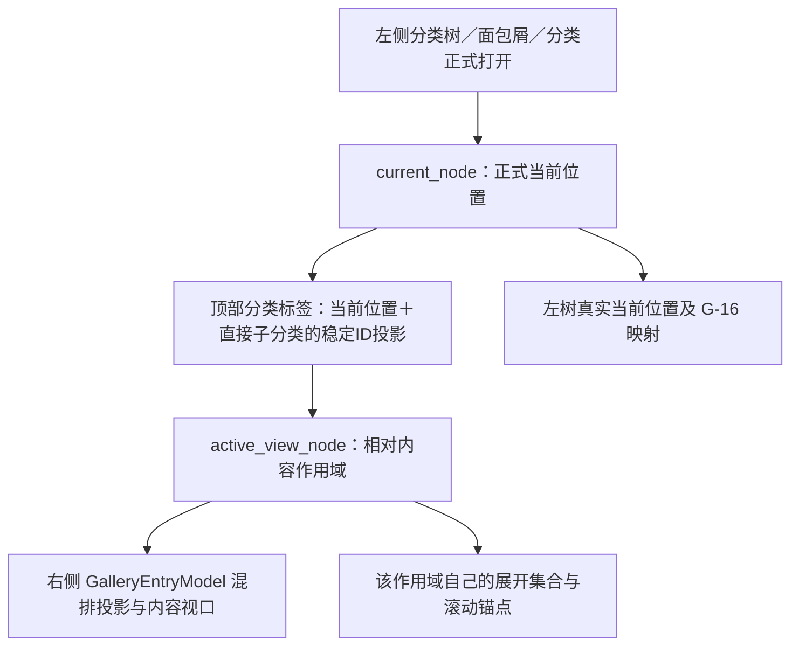

# G-05 / G-06 拖放与混排收尾

2026-10-25；接管 `dev/post-0.2.1` / `648bc00`。G-06 源码 `5248f12`；G-05 源码 `53bf192`。两项已实现／机器验证／待人工验收，#17、#18 保持 Open。未新建 Issue，未 Push／发布。

## 阶段 A：实际导航与数据合同

顶部不是任意网页式 Tab，也不是通过名称寻找分类；`_tab_nodes` 与标签索引对应稳定分类 ID。
ROOT／全部表情页当前隐藏该条；“最近使用”是独立按钮状态，不是可以任意收资源的特殊 Tab。
用户所称“上方滚动／展开区域”，本轮能确认的是 `category_tabs` 的横向翻页和右侧内容的 inline disclosure；没有发现一个需要为此联动展开的独立分类模型。

- 正式导航：`GalleryInterface.set_node()` 更新 current_node、复位 Relative、以 reveal=False 同步左树；右侧双击／Enter／菜单打开走此入口。
- 标签点击：`_on_category_tab()` → `set_relative_view()` → content_scope_node，仅切换右侧投影。保持左树真实位置、展开和滚动；选择清理、搜索／过滤及每作用域锚点遵循既有合同。
- 展开内容：`_expanded_by_scope`／`_expanded_nodes` 控制右侧 inline 节点；不等于左树展开。StickyCategory 只是既有分类条的呈现代理，拖动期间按原机制隐藏。
- 资源有稳定 ID，可有多个 content 成员关系；“加入分类”复用已有记录、不复制文件；“移动”按来源关系处理，ROOT 及混合来源说明保留。
- 节点只有一个 parent_id，移动调整父级与同级 content 顺序，子树保持。没有“一个节点多个父级”或复制子树能力。
- #56 可以统一选择资源和节点，但异质独立混合块仍按现有规则拒绝拖动；选中祖先携带的后代按既有结构归一化，不另建选择模型。

真实接收链：源卡片／左树生成 MIME → 每个接收面的 DragSession → DropTarget → DropFeedback／EdgeAutoScroller → 单次 commit → 现有存储事务 → 增量投影及原锚点恢复。命中与提交复用同一个解析结果；落下时按稳定锚点校准并发变化。

## G-06：旧覆盖与新根因

`85aac5d` 并非无效：删除“资源碰到分类一律 INTO”的旧分支，让资源与节点共用分类条上下约30%边缘 INSERT_BEFORE／AFTER、中央 INTO；并将资源重排稳定锚点扩展到节点 ID。旧检查确实覆盖了两个未展开分类间插入资源、重新打开存储后顺序保持，以及 INTO／APPEND。本轮继续保留。

新复现与修复：

| 原有成功／失败对照 | 本次责任层修正 |
| --- | --- |
| 未展开的 B／C 条边缘可用；展开 B 后，B 最后一行资源与同级 C 的4px空隙在不同 X 坐标落入不同父级 | `_hit_test()` 利用现有 FlowIndex.tops 二分定位后续分类，把这条可见空隙统一映射至 C 前方的同级边界。没有增大行高或添加占位卡片。 |
| B 下沿与 C 上沿逻辑上同一插入槽，但原反馈在不同 Y；展开 B 时反馈还可能指在其内容之前 | `_category_insertion_rect()` 只规范提供给原 DropFeedback 的锚点，使同一边界共用一条实际位置，B 后方落在可见子树之后。没有改变布局。 |
| 节点相对节点已有移除块后的槽位；节点插到资源前仍用未移除自己的旧 position，最终偏一 | 复用 `_node_insert_index()`，提交时重新解析稳定 target_id，保留已有事务／混排顺序。 |
| 将节点拖入后代可能显示可接受；存储层原本会拒绝，因此不能据此宣称数据已成环 | 复用左树 `_is_descendant()`，在反馈前拒绝自身／后代父级及非法 APPEND；移除旧的完整 subtree 查询。 |

分类条自身边缘、中央 INTO、首项之前、末项 APPEND、资源卡片间隙仍沿原 DropContract。资源行外的纵向空白不再以图片的左右半边猜测前后。筛选／显示排序／搜索的既有排序限制保留。

## G-05：确认后的最终规则与实现

原状态：通用 TabStrip 只有选择／翻页／绘制，没有分类投放接收；忽略的事件会向 GalleryInterface 传播，但不在内容视口内，最终没有合法提交。没有一个现成的顶部投放业务入口。

本轮对资源与节点菜单的初始描述曾有冲突。用户已最终确认：**资源沿用左侧添加／移动菜单；节点直接沿用左侧结构移动、不复制、不额外确认。** 旧“用户未说明意图”的状态撤回，不新增节点复制能力。

`53bf192`：

- 仅为图库实例的 `category_tabs` 设置接收及原 eventFilter；不修改通用 TabStrip 绘制、标签装饰线、设置标签、动画或翻页机制。
- 接收复用左树 `begin_drag_session()`／`resolve_category_target(id,.5,mime)`／`commit_target()`，无第二套节点合法性规则或提交算法。资源继续发 resources_dropped，调用同一个 request_resource_drop／SafeRoundMenu；节点继续发 nodes_dropped，调用原 move_nodes。
- 悬停延迟复用左树的 `HOVER_EXPAND_MS=700`。快速经过／换目标会重新计时，离开／取消／隐藏／几何或标签身份变化清理；到期只调用 `_on_category_tab()`，不提前弹菜单或写数据。是否可悬停与是否可投放由同一目标解析决定。
- A→自身及后代标签整块拒绝，不启动计时或菜单；多节点中任一源与目标冲突均拒绝。资源已有成员关系仍允许悬停继续排序，添加／移动结果由已有成员规则决定。
- 相对切页会按 #56 清理选择，因此在原资源 MIME 外附本次拖动的来源成员关系。DragSession 携带该有限上下文，左树／顶部／内容接收均沿用。没有永久缓存、另一套资源索引或源文件交付改造；G-27 的惰性临时副本策略不变。
- VirtualGallery 保留正在 QDrag 的源控件身份直到 exec 返回，退出投影后隐藏、暂不回收重绑；结束后沿原 sync 收尾。节点复用资源已有的结束清理入口，旧页面卡片不留在新页面上。
- parent GalleryInterface 只接收真正内容视口内的初始拖入，避免一个被拒绝的标签目标冒泡成错误的“图库可接收”。内容视口内空隙的正常接收保留。
- 菜单仍以实际释放的全局坐标传给原 G-04 路径，由 SafeRoundMenu 执行所在屏幕的边界夹取；没有顶部专用定位或“跟随”计时器。

## 验证与真实边界

修前已有明确失败信号：节点相对资源的索引、后代目标反馈，及校正到真实资源列 X 后的展开分类间隙父级不一致；G-05 的合成 Qt Drop 不提交、停留不切换。

定向验证：本轮边界6项、顶部7项；原 WP-B3项；交叉组合包含 active drop、Relative 导航、Sticky、外部临时副本和导入顺序共28项通过。统一选择／TabStrip 组合中原项通过，新 invalid 断言暴露事件冒泡后已修正重验；新增实际资源源控件/MIME/生命周期及节点子树检查已通过。各组合有重复，不累计为独立测试数，不宣称全项目回归。

覆盖：

- A资源→B节点→C节点→D资源的 B 前后、B/C 整条4px空隙、C 前后、首项前、末项后、节点中央；单资源／同类多选、节点相对资源、跨层父级、重开后的顺序及成员保持。
- 资源菜单取消不写；加入不删除原分类；移动只删除来源关系、保留其它分类成员；节点移动保留子分类和内部内容；节点自身／后代／多节点冲突整块拒绝。
- Relative 切换后左树有实际滚动范围时的 current／expanded／scroll 不变；正常选择、静态装饰线和显示排序入口不改。
- Qt 实际控件中滚动标签、缩窄窗口后校验菜单取当前释放点及屏幕夹取，目标名称与稳定 ID 对应，无旧位置回退。原 SafeRoundMenu 的展开实现未改。

Windows 原生检查仅在用户允许的短时间内操作私有生成样本，实际执行 QDrag.exec，核对前台、源卡片与落点、回调及持久数据：

1. 节点停留切页后继续在新内容区放置、节点自身标签无效，已验证。
2. 标签直接释放的资源菜单及取消、普通分类间隙资源插入、资源切页后继续进入真实节点并通过原菜单加入、Esc取消后无迟发切页，最终连续输入对照通过。
3. 实际资源 MIME 带原来源分类；复制关系后原来源仍在。资源“移动”按钮的多分类关系结果由 Qt 事件／存储检查覆盖，不伪称所有菜单项均已用原生鼠标逐项点击。

失败记录同样保留：首次资源检查按拖动起点固定时间采样不足以证明停留完成；下一次虽切页，但单跳释放仍交给原标签。最后使用连续原生移动并核对目标控件完成；不将前两次算通过，也不凭单跳失败改业务源码。私有记录为 DevData/wpb-closeout/native/native.json、remaining.json、remaining-final.json；不是正式版或真实 Library 的测试。

尚未验收：用户正常使用手感、其它 DPI／多显示器及真实屏幕各边缘组合。没有向聊天软件发送，不修改原图库，不以小样本证明全部大库性能。

## 状态与保护

#17/#18/#37 更新正文，保留原评论、85aac5d 的覆盖及历史时间线。独立子事项仍52条；G-05由受阻项转为已实现待人工，当前为44项已实现待人工、1当前环境已验收待发布、3部分、W-03候选／T-10调查暂缓／#53观察／E-01契约待审阅各1。
CURRENT 仅记录当前范围及入口。七处 W-01 实验逐项保持，不暂存；W-03候选、#57、T-06/T-07、材质／动效及其它成果不改。
固定 Demo 仍为 DevData/Demo/Start-Demo.cmd，持续数据和排序不重置；停在人工验收，不自动扩展其它工作包。
